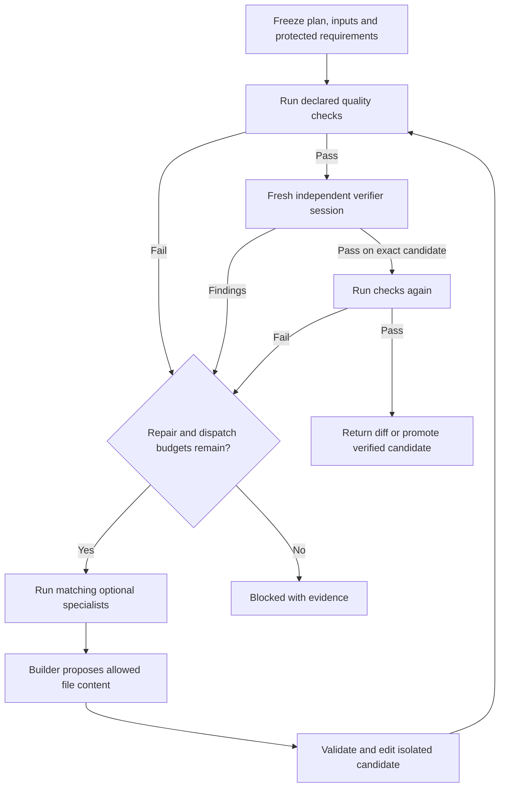

# Native agent execution bridge

Proof Loop can now run a bounded local task through real Codex worker sessions.
The bridge owns dispatch, evidence, file application and stopping rules. The
existing deterministic `orchestrate` demo and portable receipt validator remain
separate entry points.

For ordinary code fixes, use [the one-request workflow](ONE-REQUEST-WORKFLOW.md):
configure a project profile once, then pass the task to `fix --request`.



## Run the small demonstration

Use Python 3.10+ on a POSIX host (macOS/Linux) and a current installed Codex CLI
signed in with `codex login`. Native dispatch was exercised with CLI 0.154.0 and
ChatGPT authentication. No Python packages or API keys are required. Actual
worker calls consume the signed-in account's usage allowance; no fixed cost is
promised. The bridge does not install Codex or change authentication.

Copy the example so its deliberate defect stays intact:

```sh
cp -R examples/agent-bridge /tmp/proof-loop-agents-demo
python3 proofloop agent-run --root /tmp/proof-loop-agents-demo \
  --run-id demo --plan plan.json
```

This runs a failing addition check, creates a builder to propose the correction,
edits the isolated candidate, repeats quality checks and starts a
separate verifier session. After a pass it reruns checks before promoting the
verified file change. The final result remains `completed_advisory` with
`acceptance: not_accepted`. Zero defects found by a model is a scoped judgement,
not general proof of correctness or portable acceptance.

## Define a real task

The JSON plan is explicit authorization for its declared scope:

- `goal`: observable outcome, with protected requirement files in `files`.
- `files`: exact, normalized project-relative files available in each snapshot.
  A missing file is allowed only as a declared prospective file; protected files
  must already exist. There are at most 200 files and 2 MiB of initial content.
- `editable`: nonempty subset that builders may propose changing. No deletion,
  rename, binary patch or directory-wide write authority. Changes use complete
  UTF-8 file contents, bounded to 2 MiB per proposal.
- `protected`: nonempty, disjoint subset containing requirements/checks that must
  remain byte-identical. The plan itself is always protected separately.
- `quality`: nonempty list of approved argument arrays. `{python}` expands to the
  current Python executable. Commands run without a shell, in a snapshot. They
  must not mutate that snapshot, detach child processes or access live services.
  Declare their source dependencies in `files`; this is not an automatic import
  or dependency installer.
- `specialists`: zero to two approved roles with `id`, `instructions` and `when`.
  Triggers are `quality_failure` and `verification_failure`. Matching roles run
  only when there is a failed candidate and repair budget remains. This routing
  is deterministic, not an unrestricted model-generated staffing plan.
- `max_repairs`: 0–2; `max_agent_calls`: 1–12, counting specialists, builders and
  verifiers. A dispatch consumes budget before launch, including failed attempts.
- Optional `requirements`: unique IDs and descriptions that the verifier must assess
  individually with evidence. A failing or `not_checked` requirement prevents a pass.
- Optional `test_adapter`: `python-unittest`, exact protected Python test files and
  `expected_ids`. Missing, repeated, skipped or unsuccessful tests prevent a pass.
  This is local test evidence, not a portable acceptance adapter.
- Optional `delivery`: `apply` (the default for `agent-run`) or `diff`. `fix` always
  selects `diff`; the task request cannot grant itself source-write authority.
- `agent_timeout_seconds`: 1–600; `check_timeout_seconds`: 1–300;
  `max_run_seconds`: 1–1800. The total deadline persists across resume and includes
  time spent paused. Limits stop work; the bridge does not raise them itself.

The default example needs a builder only because its initial quality check
fails. Even if initial quality already passes, the goal still requires a fresh
verifier. Verifier findings return to a builder only within the approved budget.
Optional specialists can advise, but cannot approve their own work.

## What actually executes

Each worker is a separate ephemeral `codex exec --json` process with structured
output, a read-only snapshot and no resumed builder conversation. The bridge
checks the native `thread.started` and `turn.completed` events, matching final
response, exit status and exact candidate fingerprint. Worker thread IDs cannot
be reused within a run. The verifier sees the goal, protected files and quality
evidence, not builder/specialist narratives. These are fresh native sessions,
not authenticated independent humans or secret evaluation hosts.

Children run with user configuration ignored, approvals set to never, and
subdelegation, memories, apps, plugins, hooks, computer use and browser features
disabled. User policy rules are not disabled. Native authentication remains in
Codex's existing store. API-key environment variables are removed from child
processes. Model selection uses the native default; a model name is not invented
from a role label. This first adapter has no per-role model selector.

Only the bridge applies proposed changes. Repairs stay in a separate candidate
directory until checks, fresh verification and final checks pass. It validates
the entire proposal, saves prior contents and edits only explicit allowlisted
files. After each stage it rechecks source, candidate, declared file and parent-directory
modes, protected controls and all nested prior evidence. A repeated candidate stops as no progress.
Snapshots do not bind timestamps, ownership, ACLs, inode identity or undeclared files;
checks that depend on them require a different verification approach.
On POSIX hosts, declared permission bits are preserved when files are copied into
quality/worker snapshots and when existing files are rewritten; newly created
files use owner-only `0600` permissions. The executable-script regression is
covered by `tests/test_snapshot_permissions.py`. Same-user files and model identities are evidence,
not cryptographic attestations. A hostile host can tamper with its own database;
this implementation is not an OS security boundary.

## Checkpoints, cancellation and failure

```sh
python3 proofloop agent-run --root /path/to/project --run-id RUN --plan plan.json --max-steps 1
python3 proofloop agent-cancel --root /path/to/project --run-id RUN
python3 proofloop agent-preflight --root /path/to/project --plan plan.json
```

Repeat the same `agent-run` to continue a completed checkpoint. `--max-steps`
counts state-machine steps, including optional-role routing, not model turns.
A completed replay rechecks evidence and returns without another model call or
file edit. A different plan or changed declared file rejects continuation.
Preflight inspects the declared scope, executable availability and static Python
dependency hints without running project code or authenticating Codex.

The shared coordinator database records actual process references and artifacts,
with the project writer resource held for each stage. Stages run sequentially;
this adapter does not launch multiple builders concurrently. The host verifies
all prior stage artifacts before each dispatch, then uses a single-task
coordinator run per stage. Its records remain separate from portable receipt
acceptance. The project lock prevents overlapping bridge hosts.

Cancellation is cooperative at process polls and commit boundaries. The bridge
attempts to kill its owned POSIX process group on every completion or stop, even when the
leader has already exited, and checks cancellation/time again before applying
edits or publishing completion. It does not control intentionally detached
process groups; use only trusted quality commands. Windows is rejected until a
proper process-tree controller exists.

Cleanup records `cleanup.json`, including the original failure, group-signal errors
and whether the leader was reaped. If signaling the group fails, cleanup still
attempts to kill and reap its owned direct child within a five-second cleanup
allowance. A failed group signal is resolved only when a subsequent group probe
reports that no such group exists. An existing or inaccessible group, or a failed
reap, leaves the stage uncertain and prevents completion. A successful kill signal
means termination was requested; zombie reaping by the OS is not guaranteed.
Cleanup behavior is exercised by `tests/test_process_cleanup.py`; those synthetic
checks do not establish containment of arbitrary host processes.

A crash, malformed response, missing final event, runtime failure or uncertain
write leaves its active stage recorded and is never automatically redispatched.
Inspect the recorded process, coordinator state, backups and actual files. Do
not delete a lock or clear active state merely because time passed. A new run
requires deliberate reconciliation of the original work. Multi-file final
promotion is journaled but is not a rollback transaction; interrupted source
writes remain visible and require inspection. After inspecting the recorded
processes and evidence, `agent-recover --root PROJECT --run-id RUN --plan PLAN
--finish-promotion` can finish that exact verified promotion without new model
calls, using a separate bounded local recovery deadline even after the original run expires.
It checks for conflicting source edits and changed journals or backups before writing.
The comparison and file replacement are separate operations; an unrelated editor writing
between them can be overwritten. Pause non-Proof Loop writers during promotion or recovery.
The journal retains pre-run backups, but cannot capture every racing external write. The
one-request `fix` path returns a patch and does not perform source promotion.

Evidence lives under `.proof/agent-runs/RUN/`: frozen state, snapshots, command
arguments, process references, raw events, final responses, prior file contents
and nested hashes. These logs can contain task data; they are local, not
published automatically. Status 0 means a checkpoint or completed advisory run;
blocked, cancelled and uncertain work return non-success.

## Boundaries

The bridge runs only while invoked. It does not wake itself, schedule monitoring,
merge PRs, deploy, buy services, change its own permissions or promote its own
improvement proposals. The proposal-only improvement gate remains unchanged.
Host filesystem/network policy still applies. If Codex cannot initialize, the
bridge records the failure and stops without changing global configuration.

Formal portable acceptance still requires a supported recomputable adapter and
external acceptance-pin custody. The existing validator does not accept arbitrary
agent/quality reports just because this loop finished. See
[run status guide](AGENT-STATUS-GUIDE.md) for reading saved run evidence.

Native protocol reference: [official Codex non-interactive documentation](https://learn.chatgpt.com/docs/non-interactive-mode).

## Inspect without resuming

For a quick start, sample reports, exit-code meanings and tested checks, see the [Agent status quick guide](AGENT-STATUS-GUIDE.md).

```sh
python3 proofloop agent-status --root /path/to/project --run-id RUN --plan plan.json
```

The public wrapper provides this read-only command. `PLAN` must be a normalized
project-relative path, without `./`, repeated separators or traversal. It reads
existing schema-version-1, schema-version-2 or schema-version-3 state and evidence without constructing an execution
host, opening the coordinator database, taking a lock, starting a process or
writing files or bytecode. Codex and credentials are unnecessary.

The command prints one JSON object. It includes recorded state, phase, active
stage, reason, cancellation-marker presence, repair and agent-call budgets,
the existing deadline and clamped remaining time. Unknown values are `null`.
Quality and verifier summaries come from the latest completed records, never
from the state's cached quality field. A missing or malformed latest summary
cannot imply an earlier successful result is current.
New schema-3 runs keep source and candidate content and permission modes separately. Their completion requires
the fresh verifier, final recheck, and delivery or promotion sequence; the diff
must match its frozen delivery record. Managed task plans, intake evidence and
current profile hashes are checked for one-request runs. Schema-2 observations are
indeterminate because that draft format lacks mode evidence. Legacy state remains
readable but must use its original host version to resume execution.

`freshness.state` is `current`, `stale`, `unreadable` or `indeterminate`, with
explanatory `issues` for every noncurrent result. Plan, declared source files
(including absent editable files), completed results and nested evidence are
checked against their hashes. Result paths stay within this run's steps;
nested evidence stays within its own stage. Symlinks and malformed paths,
identities, counters, numeric values and evidence maps are rejected.

State bytes and cancellation-marker presence/content are compared before and
after inspection, without retry. A change, or any recorded active stage, makes
the observation indeterminate. Status does not probe a PID or infer that work
has stopped. Interpretable summaries survive ordinary hash drift and are marked
`historical: true` whenever freshness is not current.

Exit 0 means a stable, current inspection, including stable blocked or cancelled
states without active work. Exit 2 means stale, indeterminate, unreadable or
invalid input. An elapsed deadline does not change a completed advisory run's
recorded state or invalidate otherwise matching historical evidence. These exit
codes describe inspection, unlike the execution command's exit codes above.
Every report retains `acceptance: not_accepted` and
`classification: hash_consistency_only`; it does not authenticate production
acceptance or worker identity.

Validation commands for an applied candidate are:

```sh
python3 pilot/acceptance.py
python3 -m unittest discover -s tests -v
```
