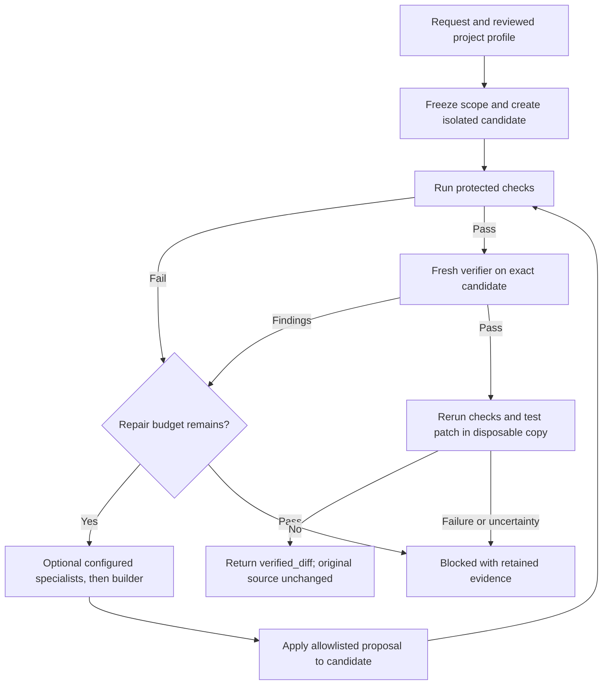
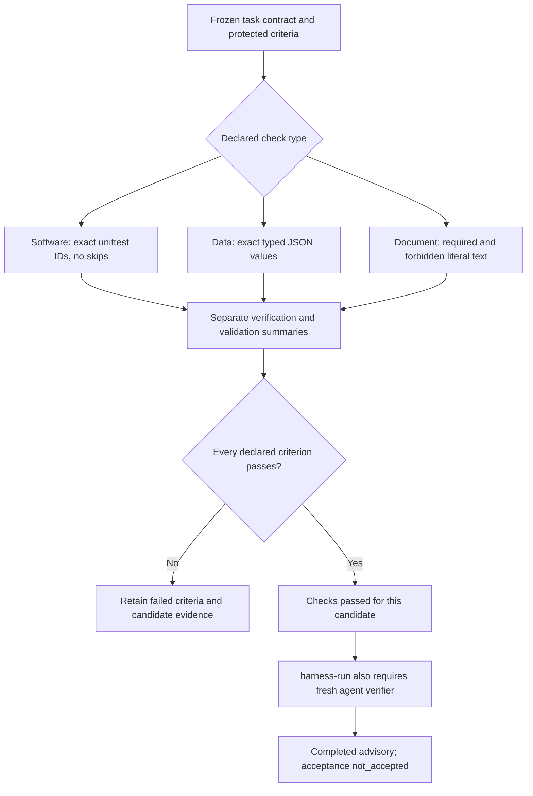
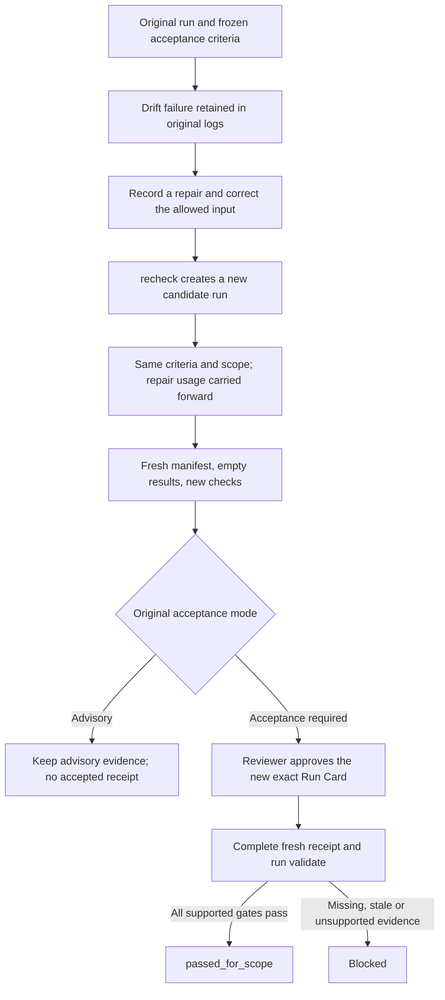
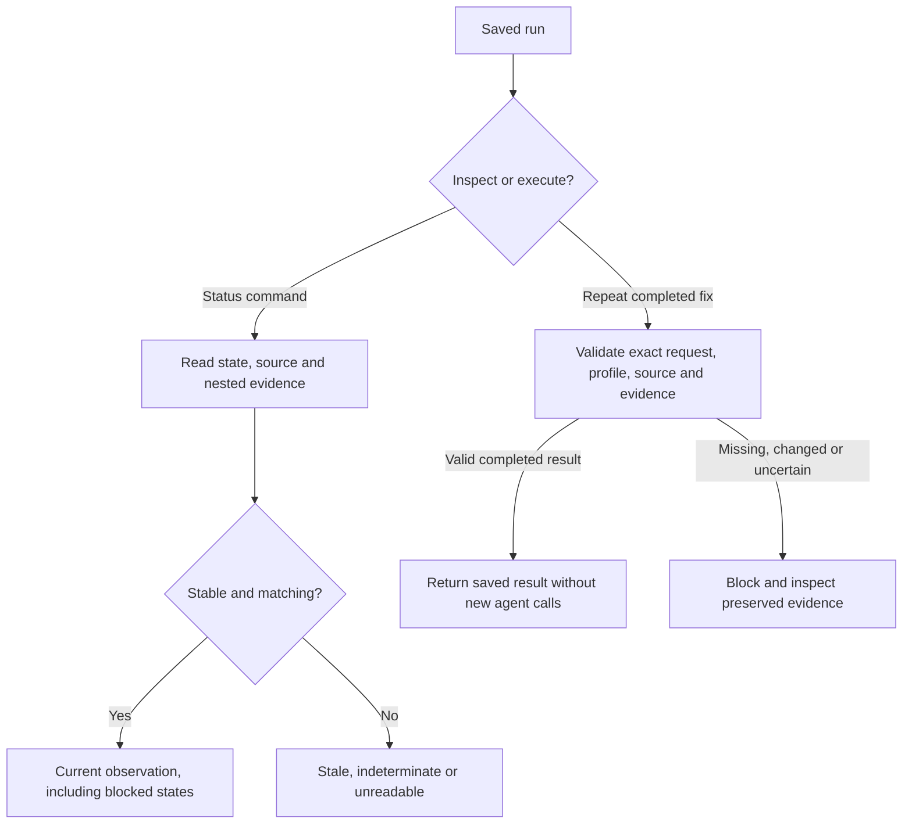
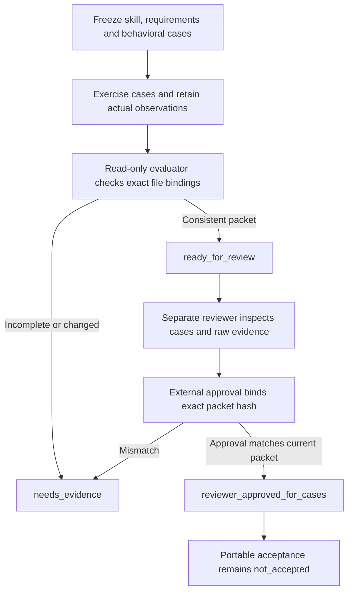

# Workflow examples

These diagrams describe implemented flows in public source [eb7d7f12](https://github.com/fuzzwin/proof-loop-public/commit/eb7d7f12d6b3ebb5bddb8296eff51bdb6ad60af2). They are illustrations, not application screenshots or new execution results. All examples below use synthetic fixtures.

## 1. Fix a small program without changing its source

The [order-total example](examples/order-total/plan.json) declares two editable files, protected requirements and tests. The project profile fixes the permitted scope and budgets before the request starts.

Use [proofloop fix](ONE-REQUEST-WORKFLOW.md) only after configuring the project. Review and apply the returned patch through the normal Git workflow. Native sessions consume the configured account's usage. A locally verified diff still has portable acceptance `not_accepted`. Runtime, evidence or cleanup uncertainty can stop any stage.

The [recorded native trials](TEST-STATUS.md#one-request-workflow-verification-2026-10-28) returned diffs for a single-file addition fix and the two-file order-total example. Those are bounded demonstrations, not proof that every project can be repaired.

## 2. Reuse one harness across software, data and documents

The included contracts cover [addition](examples/harness/software/task.json), [JSON report count and IDs](examples/harness/data/task.json), and a [release checklist](examples/harness/document/task.json). Every declared check is required; a real task may combine several types. The checks-only `harness-check` command never dispatches an agent. `harness-run` can route failures through configured specialists and bounded repairs, then recheck the candidate and obtain fresh verification. The [harness guide](HARNESS.md) specifies the complete protocol and limits.

A literal document check establishes text conditions, not factual truth. Exact test IDs establish the approved coverage ran, not that the approved coverage was sufficient. External `command-json` adapters must faithfully report failures, skips and coverage; the adapter and host remain trusted dependencies.

## 3. Repair an input without erasing the failed run

This addresses a practical trap: a repaired view can pass drift while the original receipt is stale because its input manifest describes the old view. The [recheck procedure](HOW-TO.md#repair-and-recheck-a-changed-candidate) preserves the original run instead of relabelling it. Acceptance-required rechecks need the original approved external pin, then approval of the new card. Advisory mode cannot upgrade itself. A parent cannot branch after recheck, and the chain retains its two-repair limit.

The [recheck tests](tests/test_recheck.py) cover changed criteria/cards/manifests, invalid repair counts, unsafe paths, cancelled runs and new-card approval. These test cases do not authenticate reviewer custody.

## 4. Inspect or replay without duplicating work

Status exit 0 means the inspection is stable and current, not that the task succeeded. Status does not start workers. Completed `fix` replay briefly creates a private temporary snapshot and project lock, so directory timestamps may change even when persistent source/evidence content does not. Never remove active state or locks just to force a retry. See [saved-run status](AGENT-STATUS-GUIDE.md) and [replay rules](ONE-REQUEST-WORKFLOW.md#inspect-or-repeat-a-run).

## 5. Review a skill's observed behavior

The [skill evaluator](SKILL-ACCEPTANCE.md) does not run cases or approve its own observations. `ready_for_review` means packet consistency; a producer's recorded pass is not the reviewer decision. Approval applies to declared cases, with custody always `unverified`. Changed candidate/evidence bytes invalidate the packet and approval. The [negative tests](tests/test_skill_acceptance.py) cover tampering, missing/duplicate cases, unsafe artifacts and approval scope.

## Read each result at its actual level

| Result | What it establishes |
| --- | --- |
| Checks pass | The declared checks passed for their bound candidate. |
| `completed_advisory` | Bounded execution and required fresh verifier finished within the declared gates. |
| `verified_diff` | Local checks, fresh verification, final rerun and disposable patch application matched the declared candidate. |
| `ready_for_review` | The skill packet's recorded bindings are internally consistent. |
| `reviewer_approved_for_cases` | An attributed external approval matches the exact packet and declared cases. |
| Portable `passed_for_scope` | The supported recomputable runner, fresh receipt and external pin/card gates pass. Real custody remains an external responsibility. |

None establishes universal correctness, authenticated reviewer identity, OS confinement or production readiness. See [validation limits](VALIDATION-STATUS.md) and [dated test evidence](TEST-STATUS.md).
